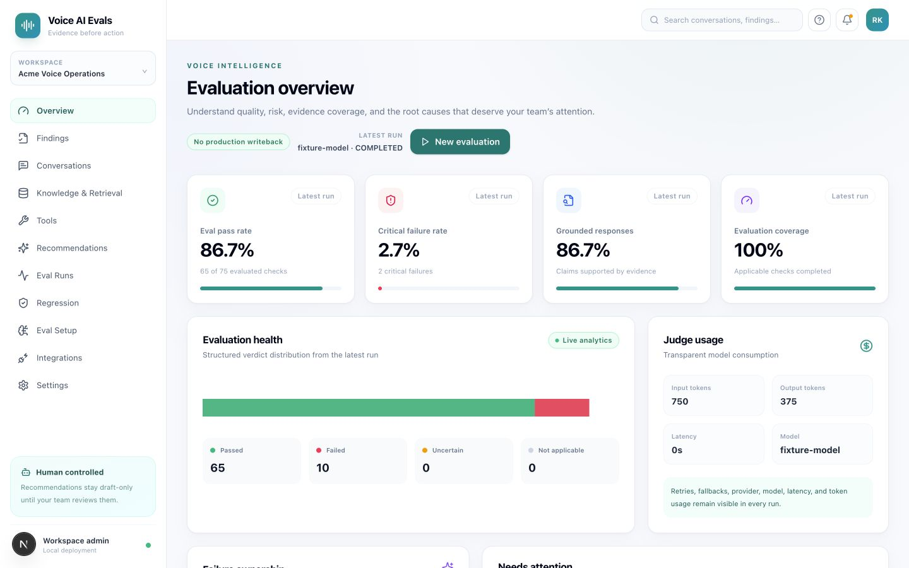
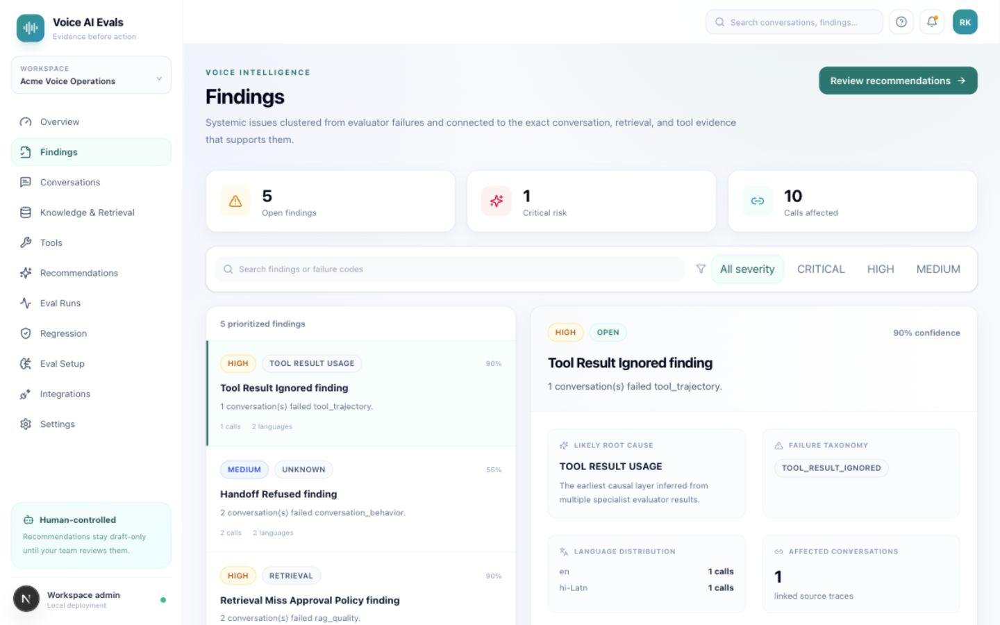
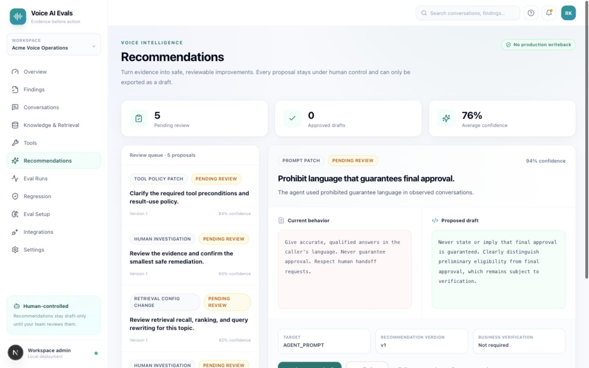

# Voice AI Evals

**Open-source, self-hostable evaluation and observability for production Voice AI agents.**

Voice AI Evals helps product, operations, QA, and engineering teams answer a practical question: *why is our voice agent failing, and what evidence supports the next change?*

The platform ingests immutable conversation traces, evaluates them with specialist LLM judges, connects failures to prompts, knowledge, retrieval, tools, and conversation policy, then prepares recommendations for human review. It works across languages and voice platforms, and it lets you bring your own model provider.

> **Safety promise:** Voice AI Evals never changes a production prompt, knowledge base, tool, or external agent configuration automatically. Approved recommendations become exportable draft artifacts only.

## Product tour

These snapshots use the included deterministic product-tour dataset: 15 realistic calls in English, Hindi, Hinglish, Tamil, and Malayalam, with 75 specialist evaluation results plus retrieval and tool evidence.

### Understand quality and risk at a glance

The overview combines pass rate, critical risk, grounding, evaluation coverage, transparent judge usage, failure ownership, and multilingual parity. Every number is derived from structured evaluator results—not parsed judge prose.



### Move from failures to evidence-linked root causes

Failures are clustered into findings and attributed to the earliest likely causal layer. Reviewers can filter by severity, compare languages, inspect affected calls, and follow references back to source traces, retrieval events, chunks, or tool calls.



### Review improvements without production writeback

Recommendations show the current behavior beside a proposed draft. Approval, rejection, edits, and exports are audited; the platform deliberately exposes no “apply to production” action.



## Who it is for

| Audience | What Voice AI Evals helps you do |
| --- | --- |
| Product and operations | Track quality, risk, language parity, and the issues affecting callers most often. |
| QA and conversation design | Run repeatable rubrics, inspect evidence, and review proposed prompt or policy changes. |
| AI and platform engineering | Diagnose grounding, retrieval, tools, model configuration, and regressions with full provenance. |
| Security and compliance | Self-host data, keep API credentials backend-only, audit human decisions, and prevent autonomous writeback. |

## How it works

1. **Connect or ingest.** Send canonical JSON/JSONL through the REST API, Python SDK, or CLI. Voice-platform connectors normalize provider-specific traces before they reach the evaluation core.
2. **Configure a judge.** Add your own OpenAI, Anthropic, Google Gemini, OpenAI-compatible, or Ollama credentials. Secrets are encrypted server-side and never stored in the browser.
3. **Run specialist evaluations.** Independent evaluators assess response quality, grounding, RAG, tool trajectory, and conversation behavior.
4. **Diagnose root causes.** The platform clusters failures, attaches observable evidence, and assigns likely ownership without hiding retries or provider fallback.
5. **Review recommendations.** A human approves, rejects, or edits each proposal. Approved work can be exported as a draft for your normal release process.
6. **Compare versions.** Regression runs compare a baseline with a candidate prompt/configuration patch using fixed cases and explicit critical blockers.

## Capabilities

- Canonical single and batch trace ingestion with lineage, immutability, and idempotency
- English, Hindi, Hinglish, Tamil, Malayalam, and code-switching in one evaluation pipeline
- OpenAI, Anthropic, Google Gemini, OpenAI-compatible, and Ollama provider adapters
- Backend-encrypted bring-your-own credentials and environment-managed credential mode
- Separate response quality, grounding, RAG, tool trajectory, and conversation evaluators
- Schema-validated LLM-as-a-judge output with retry and fallback visibility
- Evidence-linked finding synthesis and root-cause ownership
- Human approval/rejection/edit history, audit events, and draft-only JSON export
- Deterministic sampling, asynchronous Celery runs, cancellation, and immutable run snapshots
- Baseline/candidate regression comparison with deltas, new regressions, and critical blockers
- Quality, risk, failure ownership, token/cost usage, and multilingual parity analytics
- Python SDK and CLI, demo fixtures, Docker Compose, database migrations, and CI quality gates

## Five-minute Docker quickstart

### Prerequisites

- Docker Engine with Docker Compose
- Git

### Start the platform

```bash
git clone https://github.com/raajitkumar24/voice-ai-evals.git
cd voice-ai-evals
cp .env.example .env
python3 -c 'import base64, os; print(base64.urlsafe_b64encode(os.urandom(32)).decode())'
```

Put the printed encryption key into `VOICE_EVALS_ENCRYPTION_KEY` in `.env`, choose a secure bootstrap password, then run:

```bash
docker compose up --build
```

Open:

- Product UI: [http://localhost:3000](http://localhost:3000)
- Interactive API docs: [http://localhost:8000/docs](http://localhost:8000/docs)

Load the intentionally imperfect five-language loan-agent demo:

```bash
docker compose exec api voice-evals demo-load --base-url http://localhost:8000
```

In the UI, open **Integrations**, connect a judge provider, then open **Eval Runs** and evaluate the demo conversations. The fixture includes guarantee, fabricated-fee, tool-result, handoff, and correct-response cases.

## A plain-language glossary

- **Conversation trace:** the transcript plus its timestamps, language, tool calls, retrieved knowledge, and outcome.
- **Evaluator:** one focused quality check. Voice AI Evals separates evaluation families instead of asking one giant prompt to judge everything.
- **LLM judge:** the configured model that returns a schema-validated verdict and evidence references.
- **Finding:** a recurring or important failure pattern synthesized from one or more evaluator results.
- **Recommendation:** a human-reviewable suggestion tied to a finding. It is never an automatic production change.
- **Regression run:** a controlled comparison that checks whether a candidate prompt or configuration improves results without introducing new failures.

## Local development

### Prerequisites

- Python 3.12
- Node.js 22
- pnpm 11
- PostgreSQL and Redis, usually through Docker

```bash
git clone https://github.com/raajitkumar24/voice-ai-evals.git
cd voice-ai-evals
make setup
cp .env.example .env
make dev
```

The Makefile keeps the supported workflow discoverable:

```bash
make lint              # Python and TypeScript lint
make typecheck         # mypy and TypeScript checks
make test-unit         # deterministic unit suites
make test-integration  # PostgreSQL/Redis integration tests
make test-e2e          # Playwright product workflows
make test-all          # final local quality gate
make demo              # load the multilingual demo
```

`make test-live-providers` is deliberately separate because it makes paid or external provider calls. The regular test suite never requires a real provider key.

## Architecture

```text
Voice platforms / SDK / JSONL
              │
              ▼
Read-only connectors ──► canonical immutable traces ──► FastAPI / PostgreSQL
                                                          │
                                                          ▼
                                               Redis / Celery eval worker
                                                          │
                         ┌────────────────────────────────┴───────────────┐
                         ▼                                                ▼
              specialist eval-core                              LLM gateway
         quality · grounding · RAG                     routing · retry · validation
             tools · conversation                                  │
                         │                                          ▼
                         ▼                              provider-only adapters
          findings and recommendations              OpenAI · Anthropic · Gemini
                         │                        OpenAI-compatible · Ollama
                         ▼
             Next.js review and analytics UI
```

Repository boundaries are intentional:

| Path | Responsibility |
| --- | --- |
| `apps/web` | Next.js UI only; never contains provider SDK logic or secrets. |
| `apps/api` | FastAPI authentication, ingestion, orchestration, and query APIs. |
| `workers/eval-worker` | Celery execution of asynchronous evaluation runs. |
| `packages/schemas` | Canonical Pydantic contracts shared across backend boundaries. |
| `packages/eval-core` | Provider-neutral specialist evaluation and synthesis logic. |
| `packages/llm-gateway` | Model routing, retry/fallback metadata, normalization, and structured validation. |
| `packages/llm-providers` | Vendor-specific model adapters only. |
| `packages/connectors` | Read-only external trace normalization contracts. |
| `packages/sdk` | Public Python client and CLI. |
| `evals` | Versioned declarative evaluator prompts and definitions. |
| `tests` | Unit, integration, multilingual fixture, and Playwright suites. |

The two core dependency rules are:

```text
eval-core → llm-gateway → provider adapter
connector → canonical ConversationTrace → eval-core
```

Provider objects and voice-vendor payloads never enter `eval-core` directly. See [development architecture](docs/DEVELOPMENT.md) for the full module and data model guide.

## Ingesting your data

Create a workspace API key in the authenticated API, then use the Python SDK:

```python
from voice_evals_sdk import VoiceEvalsClient

with VoiceEvalsClient("https://evals.example.com", api_key="ve_...") as client:
    client.ingest_conversation(canonical_trace)
```

Or import canonical JSON/JSONL with the CLI:

```bash
VOICE_EVALS_API_KEY=ve_... voice-evals import-file conversations.jsonl \
  --base-url https://evals.example.com
```

Raw traces are append-only. Reusing an idempotency key returns the existing trace; attempting to change an already-ingested source trace is rejected. Read [API and ingestion](docs/API_AND_INGESTION.md) for canonical schemas, authentication, limits, and examples.

## Provider support and credentials

All model calls use a common provider contract with connection testing, model discovery where supported, text and structured generation, capability declaration, usage normalization, and normalized errors.

| Provider | Credential modes | Notes |
| --- | --- | --- |
| OpenAI | Encrypted database or environment | Structured judge output supported. |
| Anthropic | Encrypted database or environment | Vendor response normalized at the adapter boundary. |
| Google Gemini | Encrypted database or environment | Uses the same gateway contract as every other provider. |
| OpenAI-compatible | Encrypted database or environment | Configurable base URL for compatible hosted services. |
| Ollama/local | No secret by default | Configurable local endpoint; model capabilities are validated. |

Model names are configuration, not permanent hard-coded defaults. API keys are backend-only, encrypted at rest when persisted, masked after save, omitted from Redis job payloads, and excluded from logs and telemetry.

## Security model

- Password authentication uses secure hashes and HTTP-only sessions.
- State-changing browser requests use CSRF protection.
- Workspace API keys protect ingestion and SDK access.
- Provider secrets are encrypted with a deployment-owned key.
- Uploaded/imported content is size- and type-limited.
- Customer transcripts are not written to application logs by default.
- Rate limits protect authentication and ingestion paths.
- Source traces are immutable and recommendations are human-controlled.

For vulnerability reporting and deployment guidance, read [SECURITY.md](SECURITY.md) and [deployment and operations](docs/DEPLOYMENT.md).

## Production deployment checklist

- Set `VOICE_EVALS_ENV=production`.
- Replace the bootstrap password and keep it outside source control.
- Use a stable, backed-up 32-byte URL-safe base64 encryption key. Losing it makes stored provider credentials unreadable.
- Terminate TLS at a trusted reverse proxy and restrict `VOICE_EVALS_CORS_ORIGINS`.
- Run PostgreSQL and Redis with authentication, backups, and private networking.
- Run migrations before API startup; the supplied API image performs this automatically.
- Run the web, API, and worker images from the same release.
- Connect application logs and health endpoints to your observability platform.

## Testing philosophy

The repository tests happy paths and meaningful failures at the boundary where they matter:

- schema, ingestion immutability, evaluation applicability, gateway retry, and synthesis unit tests;
- real PostgreSQL/Redis API and migration integration tests;
- multilingual fixtures covering English, Hindi, Hinglish, Tamil, and Malayalam;
- Playwright flows from trace ingestion through evaluation, recommendation approval, and draft export;
- lint, formatting, Python typing, TypeScript typing, build, migration, and secret-scan CI gates.

## Current scope

V1 external agent integrations are read-only. Canonical REST/SDK ingestion is the stable integration path. Audio-native acoustic metrics and native adapters for every commercial voice vendor are planned extensions. No connector contract exposes a production write method.

## Documentation

- [Development and architecture](docs/DEVELOPMENT.md)
- [API and ingestion](docs/API_AND_INGESTION.md)
- [Deployment and operations](docs/DEPLOYMENT.md)
- [Security policy](SECURITY.md)
- [Contributing guide](CONTRIBUTING.md)
- [Build status and implementation coverage](BUILD_STATUS.md)

## Contributing

Contributions are welcome. Read [CONTRIBUTING.md](CONTRIBUTING.md), `AGENTS.md`, and the relevant numbered product specification before changing behavior. Add or update tests with the implementation and run `make test-all` before opening a pull request.

## License

Apache License 2.0. See [LICENSE](LICENSE).
